# StockPulse — Enterprise Multi-Tenant Inventory Management Platform

**StockPulse** is a commercial-grade, multi-tenant inventory control and procurement engine engineered for high-volume distribution hubs, multi-warehouse logistics networks, and enterprise supply chain operations.

Built on Next.js, PostgreSQL, Prisma ORM, and Tailwind CSS, StockPulse provides real-time visibility across global supply chains with strict data isolation, role-based security, and actionable operational insights.

---

## 🌟 Key Product Capabilities

### 🏢 Multi-Tenant Data Isolation
* **Tenant-Scoped Architecture**: All system entities (products, warehouses, stock levels, suppliers, and purchase orders) are strictly isolated by an `organizationId` context, ensuring enterprise data segregation and security across organizations.

### 🛡️ Role-Based Access Control (RBAC)
* **Tiered Security Clearances**: Enforces granular server-side action guards and interface access across three defined operational roles:
    * **`ADMIN`**: Full administrative workspace governance, team provisioning, user role promotion/demotion, and system-wide audit visibility.
    * **`MANAGER`**: Strategic inventory operations, purchase order issuance, shipment reception, and inter-warehouse stock transfer authorization.
    * **`OPERATOR`**: Read-only tracking, inventory level inspection, and automated stock reorder request generation.

### 📦 Multi-Warehouse Stock Tracking & Transfers
* **Centralized Inventory Matrix**: Track physical stock quantities, unit valuations, and safety reorder thresholds across distinct regional fulfillment centers.
* **Inter-Warehouse Movements**: Transfer stock between regional distribution centers with atomic balance adjustments and immutable movement logs.

### 🏭 Automated Procurement & Supplier Hub
* **Low-Stock Alert Triggers**: Automated threshold monitoring flags products reaching critical safety points for rapid reorder execution.
* **Purchase Order (PO) Management**: Generate, track, and process multi-item purchase orders from vendor suppliers directly to target destination warehouses.
* **Shipment Receiving Workflows**: One-click shipment reception updates physical warehouse stock balances and purchase order status lifecycle (`ISSUED` $\rightarrow$ `RECEIVED`).

### 📊 Intelligence, Audit & Export Center
* **Compliance Audit Trail**: Automated, immutable ledger capturing user actions, operational events, and inventory adjustments with timestamped metadata.
* **Executive Data Exports**: One-click **CSV Spreadsheet generation** for Inventory Valuations, Stock Movements, Procurement Summaries, and Audit Logs.
* **Print-Ready Reporting**: Built-in `@media print` layout formatting for generating official PDF summary receipts and hard-copy compliance reports.

---

## 🏗️ System Architecture & Technology Stack

| Layer | Technology | Purpose |
| :--- | :--- | :--- |
| **Framework** | **Next.js (App Router)** | Server Actions, React Server Components, and optimized client rendering. |
| **Language** | **TypeScript** | Strict end-to-end type safety and contract enforcement across modules. |
| **Database** | **PostgreSQL (Supabase)** | Relational database hosting tenant schemas and transactional logs. |
| **ORM** | **Prisma** | Schema migrations, type-safe query building, and relational modeling. |
| **Authentication** | **NextAuth.js (Auth.js)** | Encrypted JWT session handling with RBAC role payload injection. |
| **Styling & UI** | **Tailwind CSS & Lucide Icons** | Light Royal Emerald enterprise design theme with scalable vector SVG icons. |
| **Security** | **Bcrypt.js** | Salted password hashing for workspace user credentials. |

---

## 🔐 Security & Data Governance

* **Server Action Authorization**: Every data modification pass verifies both user session authenticity and role clearance before querying the database.
* **Audit Transparency**: All mutations (stock creation, transfers, user role modifications, and supplier additions) record the operator's identity, timestamp, and details inside the organizational audit log.
* **Credential Hygiene**: Password fields are hashed with salt rounds (`bcryptjs`) before persistence, ensuring user credentials remain secure.

---

## 🎨 User Experience & Interface Design

* **Theme**: Light Royal Emerald palette optimized for corporate desktop operation.
* **Navigation**: Persistent collapsible navigation sidebar with icon-driven UI pathways.
* **Feedback Systems**: Real-time toast notifications, dynamic state loaders, and step-by-step confirmation modals for destructive or high-impact actions.
* **Responsive Layouts**: Desktop-first layout optimization tailored for multi-monitor logistics environments and mobile inspection devices.

---

## 📸 Visual Overview

### 1. Login Screen
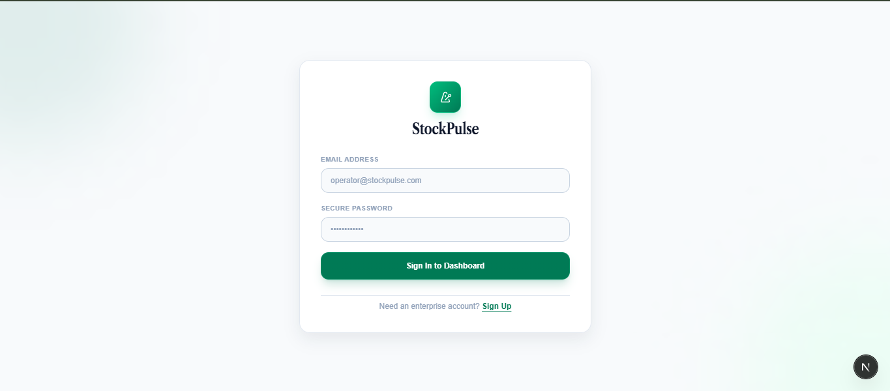

### 2. SignUp Screen
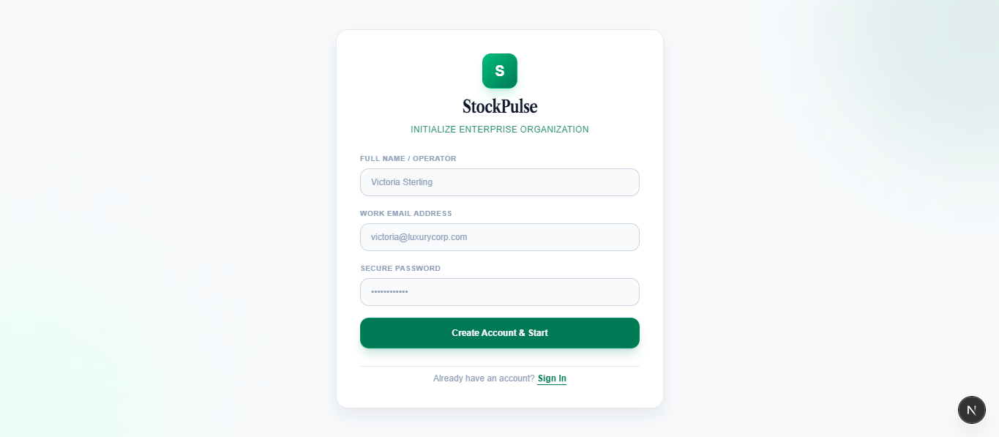

### 3. Dashboard Screen
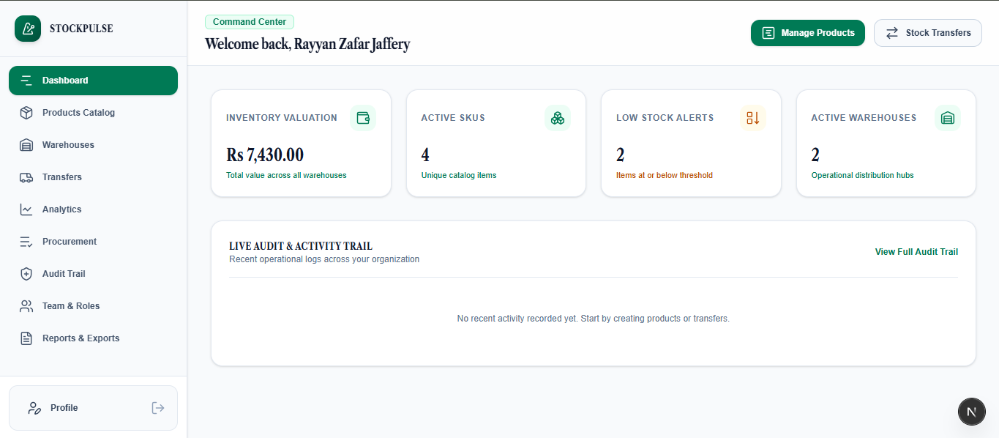

### 4. Products Catalog Screen
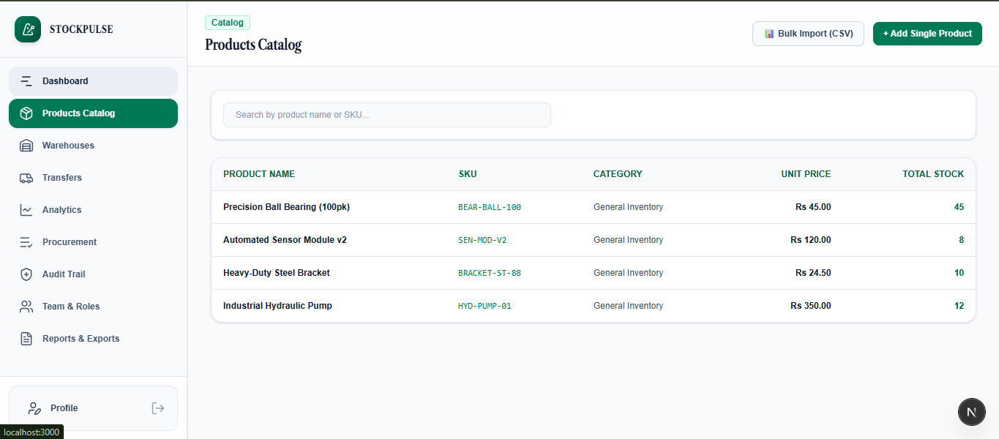

### 5. Warehouse Screen
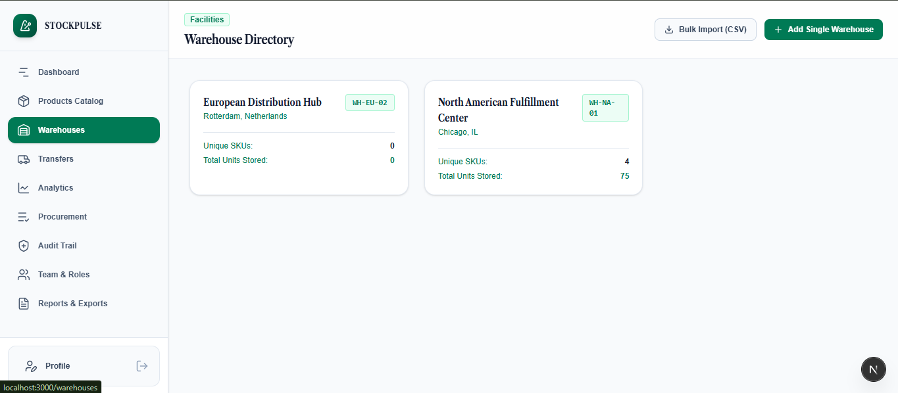

### 6. Transfer Screen
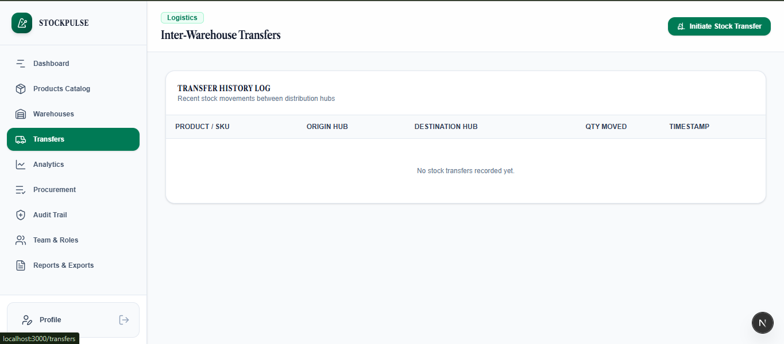

### 7. Analytics Screen
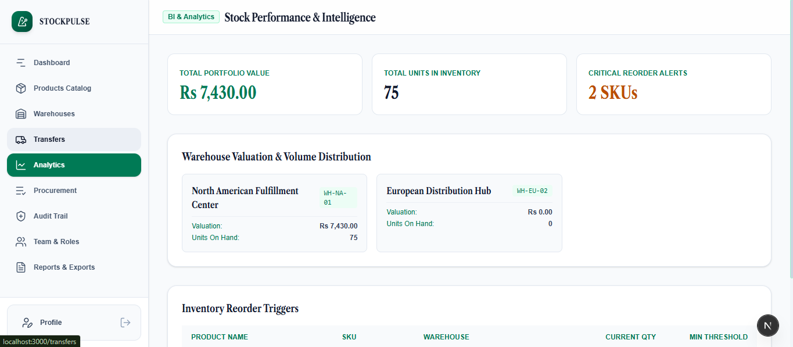

### 8. Procurement & Purchase Orders Screen
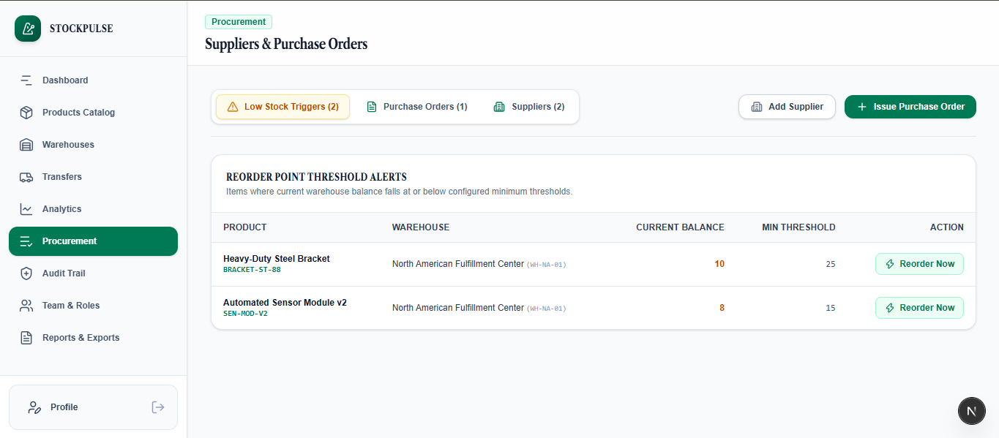

### 9. Audit Trail Screen
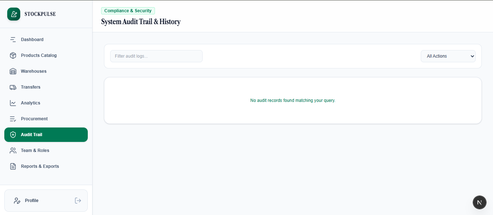

### 10. Team & Roles Screen
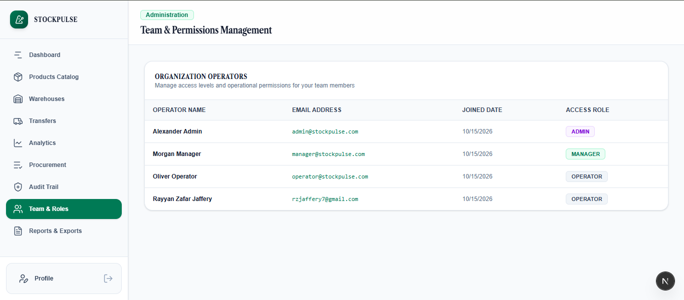

### 11. Reports & Exports Screen
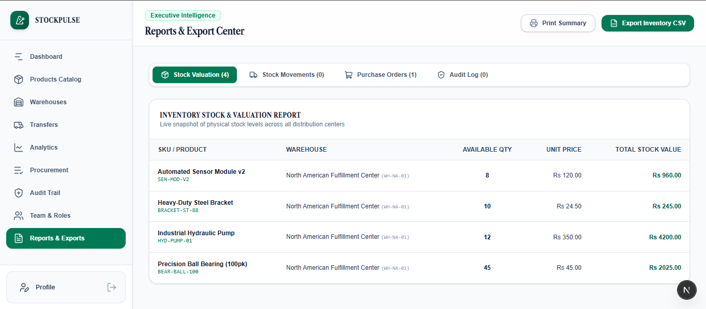

### 12. Profile Screen
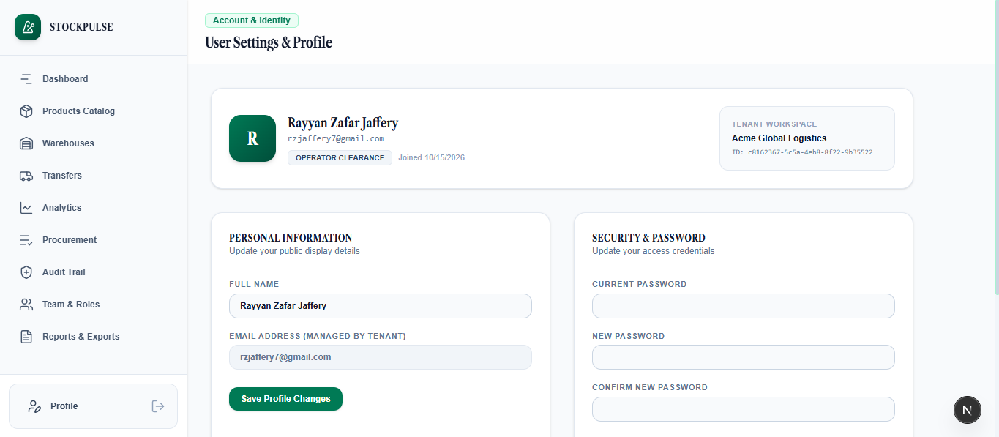

---

*StockPulse — Operational Precision for Modern Supply Chains.*